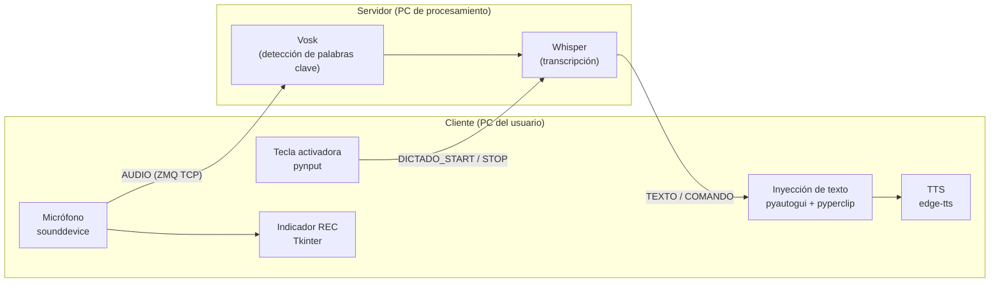

# SkipKey

**SkipKey** es la aplicación de dictado por voz: clientes para **Linux** y **Windows** que
**transcriben tu voz a texto** y además **ejecutan comandos del sistema** hablando, y un
**teclado para Android** que dicta desde el celular. Está pensada para funcionar entre dos
computadoras en la misma red local.

- En la **computadora del usuario (cliente)** se captura el micrófono, se detecta la tecla activadora y se inyecta el texto en la aplicación que tengas abierta.
- En la **computadora de procesamiento (servidor)** se hace el trabajo pesado: la transcripción con **faster-whisper** (`large-v3` en GPU).
- La **palabra clave** se detecta **en el cliente**, con faster-whisper `base`; el servidor no escucha ni sabe de comandos.

---

## Tabla de contenido

1. [Características](#características)
2. [Arquitectura](#arquitectura)
3. [Requisitos](#requisitos)
4. [Instalación del cliente (Linux)](#instalación-del-cliente-linux)
5. [Paquete instalable (otras máquinas)](#paquete-instalable-otras-máquinas)
6. [Configuración](#configuración)
7. [Uso](#uso)
8. [Comandos de voz](#comandos-de-voz)
9. [Cliente para Windows](#cliente-para-windows)
10. [Cliente Android y puente web](#cliente-android-y-puente-web)
11. [Servidor de transcripción](#servidor-de-transcripción)
12. [Estructura del proyecto](#estructura-del-proyecto)
13. [Solución de problemas](#solución-de-problemas)
14. [Privacidad](#privacidad)
15. [Licencia](#licencia)

---

## Características

- **Dictado por voz**: el texto reconocido se inyecta en la ventana activa con el portapapeles (`pyperclip` + `pyautogui`).
- **Comandos de voz**: abre y cierra aplicaciones, controla el volumen y la multimedia, captura la pantalla, bloquea la sesión y programa alarmas.
- **Asistente de voz (TTS)**: responde en voz alta con `edge-tts` (hora, fecha, saludos y, opcionalmente, consultas a DeepSeek).
- **Múltiples teclas activadoras**: `ctrl+space` y **el botón del auricular Bluetooth** (lleva por AVRCP: el cliente publica un reproductor MPRIS «SkipKey» que lo recibe), más las que quieras añadir.
- **Dos modos de activación**: *toggle* (un clic para empezar, otro para detener) o *mantener* (mantienes la tecla mientras hablas).
- **Indicador visual**: una ventana flotante muestra cuando se está grabando.
- **Modo escucha continua**: el servidor puede activar la grabación al detectar la palabra clave.
- **Dictado desde el celular**: teclado propio para Android que dicta contra el mismo servidor, incluso con datos móviles (ver [Cliente Android y puente web](#cliente-android-y-puente-web)).
- **Servicios `systemd` de usuario** para que todo arranque solo al iniciar sesión (el cliente de escritorio y el puente web).

---

## Arquitectura

Comunicación con **ZeroMQ** usando el patrón **DEALER (cliente) / ROUTER (servidor)**. Los mensajes son multipart de dos frames: `[tipo, payload]`.



- **Audio**: bloques `int16` de 1024 muestras (~64 ms) a 16 kHz, enviados de forma continua.
- **Puerto por defecto**: `5555` (configurable con `--servidor IP:PUERTO`).
- **Idioma**: español (`es`).

---

## Requisitos

### Cliente (Linux)

- Python 3.10 o superior (probado con 3.12).
- `ffmpeg` instalado (aporta `ffplay`, necesario para el texto a voz).
- Servidor de audio activo (PulseAudio o PipeWire).
- Un micrófono que funcione.

```bash
sudo apt install python3-venv ffmpeg
```

### Servidor (Linux)

- El servidor vive en **su propio repositorio** (`servidor_dictado/`): es un servicio de
  **sistema** con `faster-whisper` (`large-v3` en GPU), Vosk y `pyzmq`.
- Este repositorio no lo modifica: solo se comunica con él por ZMQ (`5555`).

### Cliente Android (opcional)

- Un celular con **Android 8.0 o superior** y el APK compilado con
  `bash cliente_android/construir_apk.sh` (requiere JDK 17 y el SDK de Android, que
  `cliente_android/herramientas/instalar_sdk.sh` instala sin sudo).
- El puente `puente_web/` publicado por HTTPS (ver [`puente_web/README.md`](puente_web/README.md)).

---

## Instalación del cliente (Linux)

```bash
# 1. Clona el repositorio
git clone https://github.com/ivanuxs/dictado-por-voz.git SkipKey
cd SkipKey

# 2. Crea el entorno virtual e instala las dependencias
python3 -m venv entorno_dictado
./entorno_dictado/bin/pip install --upgrade pip
./entorno_dictado/bin/pip install -r cliente_ubuntu/requirements.txt
```

> **Nota:** la carpeta `entorno_dictado/` está excluida por `.gitignore`. Crea la tuya; no la compartas entre computadoras, porque las rutas internas se rompen.

---

## Paquete instalable (otras máquinas)

El cliente se compila a un binario: **no se reparte código** ni hace falta Python en la
máquina destino. Se generan dos formatos desde el mismo binario.

> **Llevarlo a otra PC**: los requisitos del equipo, los paquetes del escritorio y el
> arranque/atajo están en
> [`cliente_ubuntu/INSTALAR_EN_OTRA_PC.md`](cliente_ubuntu/INSTALAR_EN_OTRA_PC.md).
> El propio binario imprime ese manual con `--ayuda`, así que también viaja dentro del
> paquete.

### `.deb` (recomendado en Ubuntu 22.04 o superior)

```bash
sudo apt install ./skipkey_1.0.0_amd64.deb
systemctl --user start skipkey      # arrancarlo ahora
```

`apt` resuelve solo las dependencias del sistema (GTK, AppIndicator, dbus, ffmpeg, xclip,
scrot, xdotool). Al entrar en la sesión arranca sin hacer nada más.

| Qué | Dónde |
|---|---|
| Programa (binario + librerías) | `/opt/skipkey/` |
| Configuración editable | `~/.config/skipkey/comandos.json` |
| Registros | `~/.local/state/skipkey/logs/` |
| Unidad de usuario | `/usr/lib/systemd/user/skipkey.service` |

Desinstalar: `sudo apt remove skipkey`. La configuración y los registros **no** se borran
(están en tu `$HOME`); elimínalos a mano si quieres dejarlo limpio.

### AppImage (otras distribuciones, o sin instalar nada)

```bash
chmod +x skipkey-1.0.0-x86_64.AppImage
./skipkey-1.0.0-x86_64.AppImage
```

Un solo archivo, sin root. Sigue necesitando en el sistema `libgtk-3`,
`libayatana-appindicator3`, `libdbus-1-3`, `ffmpeg` y `xclip` (un AppImage no puede llevar
GTK dentro sin romper el tema ni la bandeja), y en **Ubuntu 24.04** hace falta
`libfuse2t64` o ejecutarlo con `--appimage-extract-and-run`.

### Notas de los dos formatos

- **Tamaño medido**: `.deb` 127 MB y `.AppImage` 166 MB (instalado, 570 MB en `/opt`).
  El peso son las librerías de la escucha local (`ctranslate2` 72 MB, `onnxruntime` 44 MB,
  `numpy` + OpenBLAS 40 MB, los códecs que trae PyAV ~60 MB) y el binario compilado a código
  nativo con Nuitka (260 MB sin comprimir). Si se quiere un paquete del tamaño del `.exe` de
  Windows (~58 MB) hay que empaquetar con PyInstaller en vez de Nuitka, a cambio de que el
  bytecode se pueda extraer.
- El binario **no incluye el modelo de voz**: faster-whisper `base` (~142 MB) se descarga la
  primera vez que se usa. Sin internet en ese momento, la tecla activadora funciona igual.
- Se compila en **Ubuntu 22.04** a propósito: así corre también en 24.04 y 25.x (lo
  compilado en una versión nueva no arranca en una vieja).

### Para construirlo

```bash
bash cliente_ubuntu/empaquetado/construir_binario.sh            # VERSION=1.1.0 bash ...
```

Compila con **Nuitka** dentro de un contenedor `ubuntu:22.04` (hace falta Docker) y deja en
`cliente_ubuntu/empaquetado/salida/` el `.deb` y el `.AppImage`. La primera compilación
tarda entre 30 y 60 minutos; las siguientes aprovechan la caché.

El cliente empaquetado corre en **un solo ejecutable**: los procesos hijos (icono de la
barra, reproductor MPRIS y ventana de configuración) se lanzan con banderas internas del
propio binario (`--bandeja`, `--mpris`, `--ventana`), porque en el paquete no hay scripts
sueltos ni un Python del sistema con `gi`/`dbus`.

---

## Configuración

### 1. Dirección del servidor

El cliente necesita saber dónde está el servidor de transcripción. Tienes tres formas de indicarlo, en orden de prioridad:

| Método | Ejemplo |
|---|---|
| Argumento de línea de comandos | `--servidor 192.168.1.50:5555` |
| Variable de entorno | `DICTADO_SERVIDOR=192.168.1.50:5555` |
| Campo `"servidor"` en `comandos.json` | `"servidor": "192.168.1.50:5555"` |

Si no defines ninguno, se usa `127.0.0.1:5555` (útil si cliente y servidor están en la misma computadora).

### 2. Teclas y comandos

Edita `cliente_ubuntu/comandos.json`:

```json
{
  "tecla_activadora": ["media_play_pause", "ctrl+space"],
  "tecla_activadora_escribir": ["ctrl+alt+space"],
  "dispositivo_entrada": "interno",
  "boton_auricular_bluetooth": false,
  "modo_salida": "portapapeles",
  "modo_activacion": "toggle",
  "modo_escucha": true,
  "abre": { "firefox": "firefox", "terminal": "gnome-terminal" },
  "cerrar": { "firefox": "firefox", "terminal": "gnome-terminal" }
}
```

- `tecla_activadora`: admite una lista; se pueden usar varias teclas a la vez.
- `dispositivo_entrada`: de dónde se captura el audio. `"interno"` = micrófono de la
  computadora (recomendado). **No uses el micrófono de un auricular Bluetooth para dictar**:
  el auricular pasa a *modo manos libres* y su botón deja de enviar el comando multimedia
  (envía «colgar»), así que el botón no puede activar el dictado. También acepta `""` o
  `"default"` (el del sistema), un número (índice de `sounddevice`) o parte del nombre del
  dispositivo.
- `boton_auricular_bluetooth`: `true` publica un reproductor MPRIS «SkipKey» para que
  el botón del auricular active el dictado. Viene en `false` porque **solo conviene con un
  auricular dedicado a la computadora**: con uno **multipunto** (también emparejado al celular),
  el celular se queda con el botón en cuanto hay una llamada y desde la PC no se recupera. Con
  `false`, el botón del auricular sigue controlando la música como siempre.
- `modo_activacion`: `toggle` o `mantener`.
- `modo_escucha`: `true` activa el modo de escucha continua.
- `abre` / `cerrar`: nombre que dices → comando del sistema.

### 3. Clave de DeepSeek (opcional)

```bash
cp cliente_ubuntu/.env.example .env
# Edita .env y coloca tu clave
```

Si no defines `DEEPSEEK_API_KEY`, el asistente solo responde los comandos simples predefinidos (hora, fecha, saludos) y **no** hace consultas a internet.

Si usas `systemd`, la clave se pasa por un archivo aparte que **no** está en el repositorio:

```bash
cp cliente_ubuntu/.env.example ~/.config/cliente-voz.env
chmod 600 ~/.config/cliente-voz.env
```

---

## Uso

### Ejecución manual

```bash
# Servidor en otra computadora de la red
./entorno_dictado/bin/python3 cliente_ubuntu/cliente_voz.py --servidor 192.168.1.50:5555

# Cliente y servidor en la misma computadora
./entorno_dictado/bin/python3 cliente_ubuntu/cliente_voz.py
```

### Como servicio de usuario (`systemd`)

Se ejecuta como usuario (no como `root`) porque necesita acceso a la pantalla, al audio y al teclado.

```bash
mkdir -p ~/.config/systemd/user
cp cliente_ubuntu/cliente-voz.service ~/.config/systemd/user/
systemctl --user daemon-reload
systemctl --user enable cliente-voz.service
systemctl --user start cliente-voz.service
```

Comandos útiles:

```bash
systemctl --user status cliente-voz       # Ver estado
systemctl --user restart cliente-voz      # Reiniciar
systemctl --user stop cliente-voz         # Detener
journalctl --user -u cliente-voz -f       # Ver el registro en vivo
```

> **Antes de copiar el servicio**, edita `cliente-voz.service` y ajusta la ruta del proyecto y la IP del servidor.

### Icono en la barra superior

El cliente pone un icono en la barra superior de Ubuntu (AppIndicator) con un menú
para lo que no se puede hacer con la tecla activadora:

| Elemento del menú | Para qué sirve |
|---|---|
| ☑ **Escucha continua (palabra clave)** | Enciende o apaga la escucha local (faster-whisper) |
| ☑ **Comandos por voz** | **Pausa los comandos**: lo que dictes se pega como texto, sin ejecutar acciones |
| **Dictar ahora** | Empieza o termina un dictado sin tocar `Ctrl+Espacio` |
| **Ver registro** | Abre la carpeta de registros del cliente |
| **Salir** | Cierra el cliente |

El icono cambia de color: gris (escucha apagada), verde (esperando la palabra
clave), ámbar (comandos en pausa) y rojo (grabando).

Necesita la extensión `ubuntu-appindicators@ubuntu.com` (viene activa en Ubuntu) y
que GTK3 funcione. Si no quieres el icono, pon `"bandeja": false` en
`cliente_ubuntu/comandos.json`.

### Registro de la aplicación

```bash
tail -f ~/.local/state/skipkey/logs/registro_cliente_voz.log
```

Los registros viven en `~/.local/state/skipkey/logs/` (en Linux, siguiendo el estándar XDG),
tanto con el paquete instalado como en modo fuente. Al arrancar, el cliente mueve el registro
anterior a `historial/` con marca de tiempo y empieza un archivo limpio, para que no crezcan
sin control. En Windows siguen junto al `.exe`.

---

## Comandos de voz

La palabra clave es **«computadora»** al inicio de la frase.

| Dices | Acción |
|---|---|
| *«computadora abrir firefox»* | Abre Firefox |
| *«computadora cerrar terminal»* | Cierra la terminal |
| *«computadora subir volumen»* | Sube el volumen 10 % |
| *«computadora bajar volumen»* | Baja el volumen 10 % |
| *«computadora silenciar»* | Silencia el audio |
| *«computadora reproducir»* / *«pausar»* | Controla la reproducción |
| *«computadora siguiente canción»* | Pasa a la siguiente pista |
| *«computadora anterior canción»* | Vuelve a la pista anterior |
| *«computadora capturar pantalla»* | Toma una captura de pantalla |
| *«computadora bloquear pantalla»* | Bloquea la sesión |
| *«computadora pon una alarma 5 minutos»* | Programa una alarma con sonido y aviso de voz |

Además, las preguntas simples se responden por voz sin conexión a internet:

| Pregunta | Respuesta |
|---|---|
| *«computadora qué hora es»* | La hora actual |
| *«computadora qué día es»* | El día de la semana |
| *«computadora qué puedes hacer»* | Resumen de capacidades |

### Añadir comandos nuevos

1. Añade el par en `abre` o `cerrar` dentro de `comandos.json`.
2. Para acciones nuevas (brillo, por ejemplo), amplía `procesar_comando()` en `cliente_voz.py`.

---

## Cliente para Windows

La carpeta `cliente_windows/` contiene la versión para Windows, que se empaqueta como **un solo ejecutable** `ClienteVoz.exe` con PyInstaller.

> **Importante:** PyInstaller no compila de Linux a Windows. El archivo `construir_exe_windows.bat` se debe ejecutar **en una computadora con Windows**; ahí crea el entorno virtual, instala `requisitos_windows.txt` y compila `cliente_voz.spec`.

Se instala como cliente dedicado con el Programador de tareas:

```bat
ClienteVoz.exe --instalar      :: Registra la tarea "ClienteVoz" al iniciar sesión
ClienteVoz.exe --desinstalar   :: Quita la tarea
```

Las diferencias con la versión de Linux están detalladas en [`cliente_windows/README_windows.md`](cliente_windows/README_windows.md).

---

## Cliente Android y puente web

Además del cliente de escritorio, puedes **dictar desde el celular** con un **teclado
(IME) propio**, incluso con datos móviles, sin tocar el servidor de transcripción.

```
Android (IME) ──HTTPS/WSS──▶ reverse proxy (nginx, TLS) ──▶ puente ──ZMQ──▶ servidor de dictado
```

- **`puente_web/`** — Servicio en Python (FastAPI) que **es un cliente ZMQ más** del
  servidor: recibe audio por HTTPS o WebSocket y devuelve el texto ya corregido por el
  servidor. No carga ningún modelo propio (el servidor tiene un solo modelo en memoria).
  - Rutas: `POST /api/v1/transcribe` (audio completo), `WS /ws/transcribe` (dictado en
    vivo, con texto parcial) y `GET /api/v1/salud|estado`.
  - Se ejecuta como **servicio de usuario**:
    `systemctl --user enable --now puente-web`.
  - Exige token (`Authorization: Bearer`) y limita el audio (60 s, 5 MB) para proteger la GPU.
  - Instalación y configuración de nginx: [`puente_web/README.md`](puente_web/README.md).
- **`cliente_android/`** — Teclado del sistema en Kotlin (< 800 líneas), `minSdk 26`:
  captura audio a 16 kHz, lo manda al puente y escribe el texto donde estés escribiendo.
  - Compilar: `bash cliente_android/construir_apk.sh`.
  - Uso y activación: [`cliente_android/README_android.md`](cliente_android/README_android.md).

> ⚠️ **No publiques el puerto `5555` en el reverse proxy.** La autenticación del servidor
> ZMQ es global, no por cliente: la frontera de seguridad es el puente.

---

## Servidor de transcripción

El servidor de transcripción **ya no vive en este repositorio**: está en su propio
repositorio y carpeta (`servidor_dictado/`, `github.com/ivanuxs/servidor-voz`), donde se
instala como **servicio de sistema** y usa `faster-whisper` `large-v3` en la GPU. Este
repositorio solo se comunica con él: el cliente de escritorio por ZMQ y el puente web por
ZMQ local.

> `protocolo.py` y `utils_logging.py` deben ser **idénticos** en el cliente y en el servidor. Si actualizas uno, copia el cambio al otro.

---

## Estructura del proyecto

```
SkipKey/
├── cliente_ubuntu/             # Cliente de Ubuntu/Linux (esta PC)
│   ├── cliente_voz.py          # Cliente ZMQ: micrófono, teclado, inyección de texto, comandos
│   ├── mpris_dictado.py        # Reproductor MPRIS «SkipKey» (botón del auricular Bluetooth)
│   ├── senal_cliente.py        # Manda SIGUSR1/SIGUSR2 al cliente en ejecución
│   ├── cliente-voz.service     # Servicio systemd del cliente (plantilla)
│   ├── comandos.json           # Comandos de voz y teclas activadoras
│   ├── voz_asistente.py        # TTS (edge-tts) y consultas a DeepSeek
│   ├── indicador_grabacion.py  # Ventana flotante "REC" (Tkinter)
│   ├── marcas.py               # Intérprete de las marcas del dictado
│   ├── sonidos.py              # Generación de sonidos de aviso
│   ├── protocolo.py            # Tipos de mensaje ZMQ (compartido)
│   ├── utils_logging.py        # Utilidades de registro (compartido)
│   ├── requirements.txt        # Dependencias del cliente
│   ├── .env.example            # Plantilla de variables de entorno
│   ├── empaquetado/            # Compilación con Nuitka e instalador del paquete
│   └── logs/                   # Registros antiguos (hoy van a ~/.local/state/skipkey)
├── cliente_windows/            # Cliente y empaquetado para Windows
├── cliente_android/            # Teclado (IME) de Android en Kotlin
├── puente_web/                 # Puente HTTPS/WSS hacia el servidor (para Android)
├── AGENTS.md                   # Notas de desarrollo del proyecto
├── entorno_dictado/            # Entorno virtual del cliente Ubuntu (excluido de Git)
├── entorno_web/                # Entorno virtual del puente (excluido de Git)
├── scratch/                    # Scripts de diagnóstico
├── resguardos/                 # Archivos retirados (código viejo)
└── vosk-model-es/              # Modelos Vosk antiguos (2,3 GB, ya sin uso)
```

---

## Solución de problemas

| Síntoma | Causa probable | Solución |
|---|---|---|
| No se inyecta texto | El servidor no responde | Revisa que `servidor_voz.py` esté corriendo y que la IP sea correcta |
| «Sin respuesta del servidor en 15 s» | Firewall o IP incorrecta | Abre el puerto `5555` o corrige la dirección |
| La tecla no hace nada | Tecla ocupada por otra aplicación | Prueba `scratch/detectar_tecla.py` para ver qué tecla llega |
| No se oye la respuesta de voz | Falta `ffplay` | `sudo apt install ffmpeg` |
| El botón del auricular no dicta | La función está apagada (`boton_auricular_bluetooth: false`), o el dictado toma el micrófono del auricular (el auricular pasa a *modo manos libres* y su botón envía «colgar») | Ponte `"dispositivo_entrada": "interno"` y, si quieres el botón, `"boton_auricular_bluetooth": true` (solo con auricular dedicado; comprueba con `pactl list cards` que el perfil sea `a2dp-sink`) |
| El micrófono no capta | Dispositivo de entrada mal elegido | Revisa `dispositivo_entrada` en `comandos.json` o la configuración de audio del sistema |
| Error al ejecutar `pip` | Se movió el entorno virtual | Recrea el entorno: `python3 -m venv entorno_dictado` |

---

## Privacidad

- Con el **cliente de escritorio**, el audio viaja por la red local hacia el servidor y **no sale a internet**.
- Con el **teclado de Android desde fuera de casa**, el audio sale por datos móviles pero va **cifrado (HTTPS/WSS)** hasta tu propio servidor: no pasa por ningún servicio de terceros. Dentro de casa puede quedarse en la red local.
- Las consultas a **DeepSeek sí salen a internet**, pero solo si defines `DEEPSEEK_API_KEY`. Si no la defines, esa función queda desactivada.
- Ninguna clave se guarda en el repositorio: `.env`, `cliente-voz.env` y `puente-web.env` están excluidos por `.gitignore`. En el celular, la URL, el token y la clave se guardan cifrados.
- El modelo de voz se ejecuta localmente, así que el dictado funciona **sin conexión a internet**.

---

## Licencia

Distribuido bajo la licencia **MIT**. Consulta el archivo [LICENSE](LICENSE).
