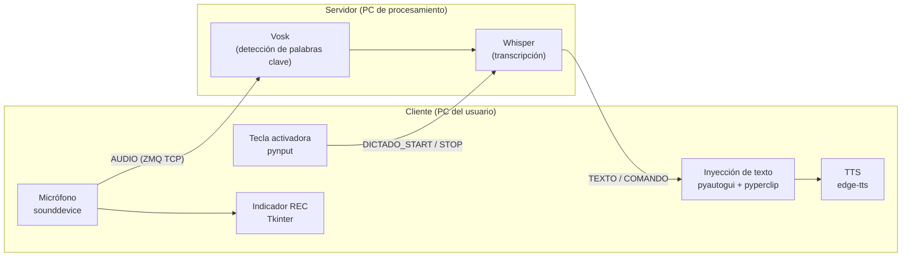

# Dictado por Voz

Herramienta de dictado por voz para Linux (con cliente para Windows) que **transcribe tu voz a texto** y además **ejecuta comandos del sistema** hablando. Está pensada para funcionar entre dos computadoras en la misma red local.

- En la **computadora del usuario (cliente)** se captura el micrófono, se detecta la tecla activadora y se inyecta el texto en la aplicación que tengas abierta.
- En la **computadora de procesamiento (servidor)** se hace el trabajo pesado: detección de palabras clave con **Vosk** y transcripción con **Whisper**.

---

## Tabla de contenido

1. [Características](#características)
2. [Arquitectura](#arquitectura)
3. [Requisitos](#requisitos)
4. [Instalación del cliente (Linux)](#instalación-del-cliente-linux)
5. [Descarga del modelo Vosk](#descarga-del-modelo-vosk)
6. [Configuración](#configuración)
7. [Uso](#uso)
8. [Comandos de voz](#comandos-de-voz)
9. [Cliente para Windows](#cliente-para-windows)
10. [Servidor de transcripción](#servidor-de-transcripción)
11. [Estructura del proyecto](#estructura-del-proyecto)
12. [Solución de problemas](#solución-de-problemas)
13. [Privacidad](#privacidad)
14. [Licencia](#licencia)

---

## Características

- **Dictado por voz**: el texto reconocido se inyecta en la ventana activa con el portapapeles (`pyperclip` + `pyautogui`).
- **Comandos de voz**: abre y cierra aplicaciones, controla el volumen y la multimedia, captura la pantalla, bloquea la sesión y programa alarmas.
- **Asistente de voz (TTS)**: responde en voz alta con `edge-tts` (hora, fecha, saludos y, opcionalmente, consultas a DeepSeek).
- **Múltiples teclas activadoras**: botón del auricular (`media_play_pause`), `ctrl+space` y las que quieras añadir.
- **Dos modos de activación**: *toggle* (un clic para empezar, otro para detener) o *mantener* (mantenés la tecla mientras hablas).
- **Indicador visual**: una ventana flotante muestra cuando se está grabando.
- **Modo escucha continua**: el servidor puede activar la grabación al detectar la palabra clave.
- **Servicios `systemd` de usuario** para que todo arranque solo al iniciar sesión.

---

## Arquitectura

Comunicación con **ZeroMQ** usando el patrón **DEALER (cliente) / ROUTER (servidor)**. Los mensajes son multipart de dos frames: `[tipo, payload]`.



- **Audio**: bloques `int16` de 1024 muestras (~64 ms) a 16 kHz, enviados de forma continua.
- **Puerto por defecto**: `5555` (configurable con `--servidor IP:PUERTO`).
- **Idioma**: español (`es`).

---

## Requisitos

### Cliente (Linux)

- Python 3.10 o superior (probado con 3.12).
- `ffmpeg` instalado (aporta `ffplay`, necesario para el texto a voz).
- Servidor de audio activo (PulseAudio o PipeWire).
- Un micrófono que funcione.

```bash
sudo apt install python3-venv ffmpeg
```

### Servidor (Linux)

- Python 3.10 o superior, `ffmpeg` y los paquetes de `servidor/requirements.txt`
  (incluye `openai-whisper`, `torch` y `vosk`).

---

## Instalación del cliente (Linux)

```bash
# 1. Clona el repositorio
git clone https://github.com/TU_USUARIO/dictado-por-voz.git
cd dictado-por-voz

# 2. Crea el entorno virtual e instala las dependencias
python3 -m venv entorno_dictado
./entorno_dictado/bin/pip install --upgrade pip
./entorno_dictado/bin/pip install -r requirements.txt
```

> **Nota:** la carpeta `entorno_dictado/` está excluida por `.gitignore`. Crea la tuya; no la compartas entre computadoras, porque las rutas internas se rompen.

---

## Descarga del modelo Vosk

El modelo de voz pesa más de 2 GB y **no está incluido en el repositorio**. Descárgalo y colócalo en la raíz del proyecto (y también en el servidor):

```bash
# Modelo en español (elige el que necesites)
wget https://alphacephei.com/vosk/models/vosk-model-small-es-0.42.zip
unzip vosk-model-small-es-0.42.zip -d vosk-model-es
```

Estructura esperada:

```
vosk-model-es/
└── vosk-model-small-es-0.42/
    ├── am/
    ├── conf/
    ├── graph/
    └── ivector/
```

---

## Configuración

### 1. Dirección del servidor

El cliente necesita saber dónde está el servidor de transcripción. Tienes tres formas de indicarlo, en orden de prioridad:

| Método | Ejemplo |
|---|---|
| Argumento de línea de comandos | `--servidor 192.168.1.50:5555` |
| Variable de entorno | `DICTADO_SERVIDOR=192.168.1.50:5555` |
| Campo `"servidor"` en `comandos.json` | `"servidor": "192.168.1.50:5555"` |

Si no defines ninguno, se usa `127.0.0.1:5555` (útil si cliente y servidor están en la misma computadora).

### 2. Teclas y comandos

Edita `comandos.json`:

```json
{
  "tecla_activadora": ["media_play_pause", "ctrl+space"],
  "tecla_activadora_escribir": ["ctrl+alt+space"],
  "modo_salida": "portapapeles",
  "modo_activacion": "toggle",
  "modo_escucha": true,
  "abre": { "firefox": "firefox", "terminal": "gnome-terminal" },
  "cerrar": { "firefox": "firefox", "terminal": "gnome-terminal" }
}
```

- `tecla_activadora`: admite una lista; se pueden usar varias teclas a la vez.
- `modo_activacion`: `toggle` o `mantener`.
- `modo_escucha`: `true` activa el modo de escucha continua.
- `abre` / `cerrar`: nombre que dices → comando del sistema.

### 3. Clave de DeepSeek (opcional)

```bash
cp .env.example .env
# Edita .env y coloca tu clave
```

Si no defines `DEEPSEEK_API_KEY`, el asistente solo responde los comandos simples predefinidos (hora, fecha, saludos) y **no** hace consultas a internet.

Si usas `systemd`, la clave se pasa por un archivo aparte que **no** está en el repositorio:

```bash
cp .env.example ~/.config/cliente-voz.env
chmod 600 ~/.config/cliente-voz.env
```

---

## Uso

### Ejecución manual

```bash
# Servidor en otra computadora de la red
./entorno_dictado/bin/python3 cliente_voz.py --servidor 192.168.1.50:5555

# Cliente y servidor en la misma computadora
./entorno_dictado/bin/python3 cliente_voz.py
```

### Como servicio de usuario (`systemd`)

Se ejecuta como usuario (no como `root`) porque necesita acceso a la pantalla, al audio y al teclado.

```bash
mkdir -p ~/.config/systemd/user
cp cliente-voz.service ~/.config/systemd/user/
systemctl --user daemon-reload
systemctl --user enable cliente-voz.service
systemctl --user start cliente-voz.service
```

Comandos útiles:

```bash
systemctl --user status cliente-voz       # Ver estado
systemctl --user restart cliente-voz      # Reiniciar
systemctl --user stop cliente-voz         # Detener
journalctl --user -u cliente-voz -f       # Ver el registro en vivo
```

> **Antes de copiar el servicio**, edita `cliente-voz.service` y ajusta la ruta del proyecto y la IP del servidor.

### Registro de la aplicación

```bash
tail -f logs/registro_cliente_voz.log
```

Al arrancar, el cliente mueve el registro anterior a `logs/historial/` con marca de tiempo y empieza un archivo limpio, para que los registros no crezcan sin control.

---

## Comandos de voz

La palabra clave es **«computadora»** al inicio de la frase.

| Dices | Acción |
|---|---|
| *«computadora abrir firefox»* | Abre Firefox |
| *«computadora cerrar terminal»* | Cierra la terminal |
| *«computadora subir volumen»* | Sube el volumen 10 % |
| *«computadora bajar volumen»* | Baja el volumen 10 % |
| *«computadora silenciar»* | Silencia el audio |
| *«computadora reproducir»* / *«pausar»* | Controla la reproducción |
| *«computadora siguiente canción»* | Pasa a la siguiente pista |
| *«computadora anterior canción»* | Vuelve a la pista anterior |
| *«computadora capturar pantalla»* | Toma una captura de pantalla |
| *«computadora bloquear pantalla»* | Bloquea la sesión |
| *«computadora pon una alarma 5 minutos»* | Programa una alarma con sonido y aviso de voz |

Además, las preguntas simples se responden por voz sin conexión a internet:

| Pregunta | Respuesta |
|---|---|
| *«computadora qué hora es»* | La hora actual |
| *«computadora qué día es»* | El día de la semana |
| *«computadora qué puedes hacer»* | Resumen de capacidades |

### Añadir comandos nuevos

1. Añade el par en `abre` o `cerrar` dentro de `comandos.json`.
2. Para acciones nuevas (brillo, por ejemplo), amplía `procesar_comando()` en `cliente_voz.py`.

---

## Cliente para Windows

La carpeta `cliente_windows/` contiene la versión para Windows, que se empaqueta como **un solo ejecutable** `ClienteVoz.exe` con PyInstaller.

> **Importante:** PyInstaller no compila de Linux a Windows. El archivo `construir_exe_windows.bat` se debe ejecutar **en una computadora con Windows**; ahí crea el entorno virtual, instala `requisitos_windows.txt` y compila `cliente_voz.spec`.

Se instala como cliente dedicado con el Programador de tareas:

```bat
ClienteVoz.exe --instalar      :: Registra la tarea "ClienteVoz" al iniciar sesión
ClienteVoz.exe --desinstalar   :: Quita la tarea
```

Las diferencias con la versión de Linux están detalladas en [`cliente_windows/README_windows.md`](cliente_windows/README_windows.md).

---

## Servidor de transcripción

El servidor (`servidor_voz.py`) vive en su propia carpeta y se copia a la computadora de procesamiento. Sus archivos son:

| Archivo | Para qué sirve |
|---|---|
| `servidor_voz.py` | Servidor ZMQ: carga Vosk y Whisper |
| `escucha_continua.py` | Detección de palabras clave con Vosk |
| `servidor-voz.service` | Servicio `systemd` del servidor |
| `protocolo.py` | Tipos de mensaje (compartido con el cliente) |
| `utils_logging.py` | Utilidades de registro (compartido con el cliente) |
| `requirements.txt` | Dependencias del servidor |

> `protocolo.py` y `utils_logging.py` deben ser **idénticos** en el cliente y en el servidor. Si actualizas uno, copia el cambio al otro.

---

## Estructura del proyecto

```
dictado-por-voz/
├── cliente_voz.py              # Cliente ZMQ: micrófono, teclado, inyección de texto, comandos
├── cliente-voz.service         # Servicio systemd del cliente (plantilla)
├── comandos.json               # Comandos de voz y teclas activadoras
├── voz_asistente.py            # TTS (edge-tts) y consultas a DeepSeek
├── indicador_grabacion.py      # Ventana flotante "REC" (Tkinter)
├── sonidos.py                  # Generación de sonidos de aviso
├── protocolo.py                # Tipos de mensaje ZMQ (compartido)
├── utils_logging.py            # Utilidades de registro (compartido)
├── requirements.txt            # Dependencias del cliente
├── .env.example                # Plantilla de variables de entorno
├── AGENTS.md                   # Notas de desarrollo del proyecto
├── cliente_windows/            # Cliente y empaquetado para Windows
├── scratch/                    # Scripts de diagnóstico
├── logs/                       # Registros (excluidos de Git)
└── vosk-model-es/              # Modelo de voz (excluido de Git)
```

---

## Solución de problemas

| Síntoma | Causa probable | Solución |
|---|---|---|
| No se inyecta texto | El servidor no responde | Revisa que `servidor_voz.py` esté corriendo y que la IP sea correcta |
| «Sin respuesta del servidor en 15 s» | Firewall o IP incorrecta | Abre el puerto `5555` o corrige la dirección |
| La tecla no hace nada | Tecla ocupada por otra aplicación | Prueba `scratch/detectar_tecla.py` para ver qué tecla llega |
| No se oye la respuesta de voz | Falta `ffplay` | `sudo apt install ffmpeg` |
| El micrófono no capta | Dispositivo de entrada mal elegido | Revisa la configuración de audio del sistema |
| Error al ejecutar `pip` | Se movió el entorno virtual | Recrea el entorno: `python3 -m venv entorno_dictado` |

---

## Privacidad

- El **audio viaja por la red local** hacia el servidor y **no sale a internet**.
- Las consultas a **DeepSeek sí salen a internet**, pero solo si defines `DEEPSEEK_API_KEY`. Si no la defines, esa función queda desactivada.
- Ninguna clave se guarda en el repositorio: `.env` y `cliente-voz.env` están excluidos por `.gitignore`.
- El modelo de voz se ejecuta localmente, así que el dictado funciona **sin conexión a internet**.

---

## Licencia

Distribuido bajo la licencia **MIT**. Consulta el archivo [LICENSE](LICENSE).
